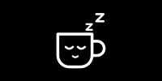

# 05 · The mug goes to sleep

October 12, 2026

When my mug was offline and heating was off, the dial said this:

```text
OFFLINE
  OFF
```

Off, and also off. I wanted one picture for "off completely from everything" instead of two words saying the same thing.

## Picking the picture

My first idea was a cup with a power symbol on it. Then I wanted something more fun that still says mug and off at the same time.

The winner was a sleeping mug: closed eyes, a tiny smile, and z's floating up where the steam would be.



The first version was gray, to look switched off. On the real dial I liked it better in white, and a little smaller. It sits on pure black, `#000000`, because the deck is black and anything lighter shows up as a box around the picture.

## The rule

The mug only shows when both lines would say off. If only one does, the text is still telling me something:

| Top line | Bottom line | The dial shows |
|---|---|---|
| OFFLINE | OFF | the sleeping mug |
| OFFLINE | a temperature | the text |
| CONNECTED · 78% | OFF | the text |

## How it works

The layout already had text boxes. I added one picture slot that covers the whole screen and sits on top of them, switched off by default.

```text
mug offline + heating off → picture on, every text box off
anything else             → picture off, text as before
```

The part I had to be careful with is the second line. The picture is on top, so every screen that shows text has to switch it off again. Miss one and the mug would nap right over my temperatures. There is a test for exactly that.

## Did it work?

With the Ember app closed and heating off, I looked at the dial. One sleeping mug, no text behind it, and no gray box around it. 🎉

145 tests pass now, seven of them new.

## What I learned

My next list has a cup with animated steam on it. I had been thinking of that as one drawing. Now it has a partner: steam when the mug is on, z's when it is off. Drawing the off state first told me what the on state should look like.
